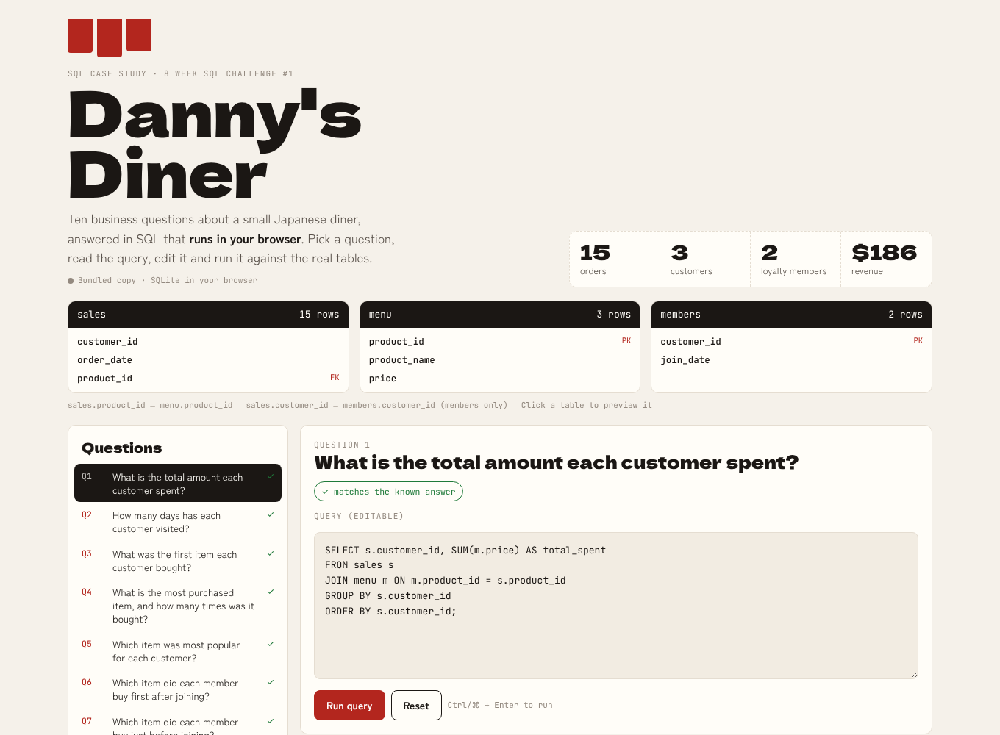
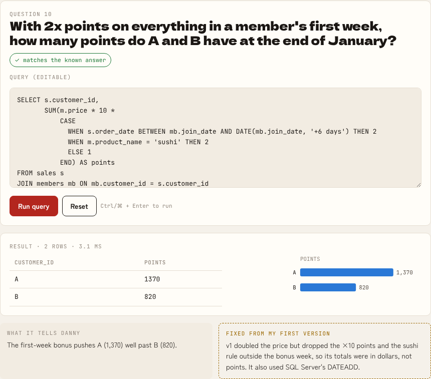

# Danny's Diner: SQL case study with an in-browser playground

**Ten business questions about a small Japanese diner, answered in SQL you can edit and run in the browser.**
Every answer is checked automatically against the known results. Rewriting the queries fixed five mistakes in my first attempt.

**[Open the SQL playground →](https://qaisbello.github.io/data-analytics/dannys-diner/)** · loads the schema and queries from [`sql/`](sql/) in this repo on every visit



## The answers

| # | Question | Answer |
|---|---|---|
| 1 | Total spent per customer | A $76 · B $74 · C $36 |
| 2 | Days visited | A 4 · B 6 · C 2 |
| 3 | First item bought | A: curry **and** sushi · B: curry · C: ramen |
| 4 | Most purchased item | Ramen, 8 times |
| 5 | Favourite item per customer | A ramen · B **three-way tie** (curry, ramen, sushi) · C ramen |
| 6 | First purchase after joining | A curry (on join day) · B sushi |
| 7 | Last purchase before joining | A curry **and** sushi · B sushi |
| 8 | Items and spend before joining | A 2 items, $25 · B 3 items, $40 |
| 9 | Points (10/$, 2x on sushi) | A 860 · B 940 · C 360 |
| 10 | Points incl. first-week 2x, end of January | A 1,370 · B 820 |

**For Danny:** ramen is the menu's anchor (8 of 15 orders). B is the most frequent visitor but no single dish holds them. Sushi appears in both members' last orders before joining, which makes it a natural hook for the loyalty programme.

## What I fixed from my first version

My original script ([`legacy/diner_v1.sql`](legacy/diner_v1.sql)) ran, but several answers were wrong:

| Question | Problem in v1 | Fix |
|---|---|---|
| Q2 | `COUNT(order_date)` counts orders, not days, so A showed 6 visits instead of 4 | `COUNT(DISTINCT order_date)` |
| Q3, Q5, Q7 | `ROW_NUMBER()` picks one arbitrary row when items tie, which hid A's two first-day items and B's three-way tie | `RANK()` / `DENSE_RANK()` keep every tie |
| Q6 | `order_date > join_date` skipped A's join-day order | `>=`, with the business rule written in a comment |
| Q10 | Doubled the price but dropped the ×10 points and the sushi rule outside the bonus week, so it returned dollars, not points | One `CASE` covering both multipliers |
| Q4, Q10 | Mixed SQL Server syntax (`TOP 1`, `DATEADD`) into a MySQL script | Portable SQL (`LIMIT`, `DATE(... '+6 days')`) |

## How it works

- [`sql/schema.sql`](sql/schema.sql) creates the three tables. Each question lives in its own file (`sql/q01.sql` … `q10.sql`, plus two bonus queries).
- [`src/run_all.py`](src/run_all.py) runs every query with SQLite, checks it against [`answers/expected.json`](answers/expected.json), and writes [`answers/results.md`](answers/results.md).
- The playground ([`web/`](web/)) loads SQLite into the page with [sql.js](https://github.com/sql-js/sql.js), fetches the schema and queries from this repo, and marks each answer ✓ when it matches. Visitors can edit any query or write their own.



## Skills shown

SQL (joins, CTEs, window functions: `RANK`, `DENSE_RANK`, conditional aggregation) · translating business rules into queries · handling ties and edge cases · automated answer checks · interactive SQL in the browser

## Run it

```bash
python src/run_all.py        # runs and checks every query (SQLite, no install needed)
python build.py              # builds web/index.html
python -m http.server        # then open http://localhost:8000/web/
```

---
Case study and data: Danny Ma, [8 Week SQL Challenge](https://8weeksqlchallenge.com/case-study-1/). Queries, checks and playground by **Qais Adeniji-Bello** · [qaisbello.github.io](https://qaisbello.github.io) · [LinkedIn](https://www.linkedin.com/in/qais-adeniji-bello/)
